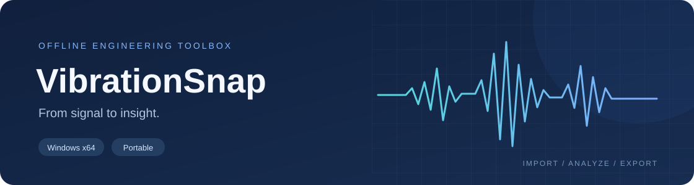
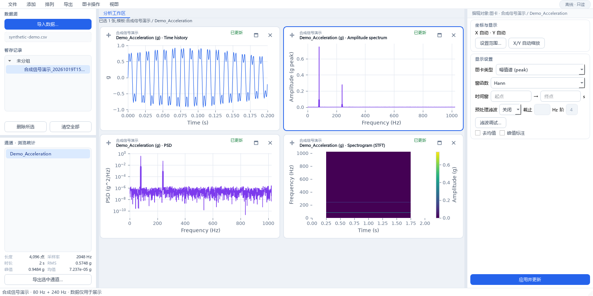
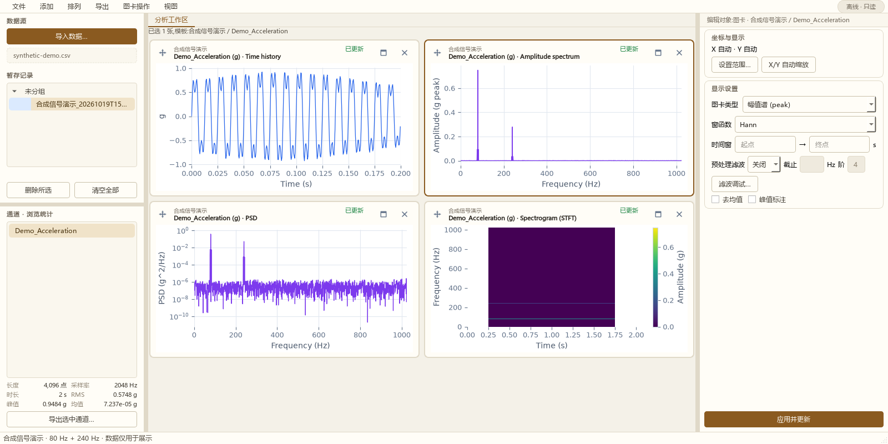

<p align="center">
  
</p>

<p align="center">
  <strong>从一段测试数据，到一组清晰的分析图。</strong><br>
  面向振动测试与分析的离线桌面工具箱。
</p>

<p align="center">
  Windows x64 &nbsp; / &nbsp; 便携运行 &nbsp; / &nbsp; 无需 Python &nbsp; / &nbsp; 原始数据只读
</p>

<p align="center">
  <a href="https://github.com/Mark54s/SnapSandrone-Releases/releases/latest"><strong>下载最新版本 →</strong></a>
  &nbsp;&nbsp; · &nbsp;&nbsp;
  <a href="#快速开始">快速开始</a>
  &nbsp;&nbsp; · &nbsp;&nbsp;
  <a href="https://github.com/Mark54s/SnapSandrone-Releases/releases">更新记录</a>
  &nbsp;&nbsp; · &nbsp;&nbsp;
  <a href="https://github.com/Mark54s/SnapSandrone-Releases/issues">问题反馈</a>
</p>

---

## 一个工作区，几种观察信号的方式

导入数据、选择通道，为时域、频域或时频分析各建一张图卡。参数跟随图卡保存，浏览其他通道时，已有图表仍留在原处。

<p align="center">
  
</p>

<p align="center"><sub>大肥鱼（DeepSeek）主题 · 截图使用合成信号，不包含实验数据。</sub></p>

### 从导入到交付

| 01 · 整理数据 | 02 · 查看与分析 | 03 · 出图与导出 |
| :--- | :--- | :--- |
| TDMS / CSV / TXT 导入 | 时域、幅值谱、Welch PSD | PNG / PDF / SVG 图片 |
| 文件夹扫描、分组与通道浏览 | STFT、包络谱、倒谱、倍频程 | 通道数据与分析结果导出 |
| 裁剪、去均值、高通 / 低通滤波 | 互谱、相干与时域统计 | 多图批量导出、Word 图片报告 |

- **对比更直接。** 一卡一图，支持拖动排序、专注查看，以及多卡参数与坐标范围设置。
- **过程可追溯。** 处理产生派生结果；原始文件只读。工作区可保存来源引用、参数和视图配置。
- **本地就能完成。** 默认离线，无需登录，不上传测试数据。普通分析和图片导出无需 MATLAB。

## 快速开始

**当前版本：`v0.0.1-beta.3` · Windows x64 · 早期测试版**

1. **下载。** 获取 [Windows 便携包（ZIP，约 107 MiB）](https://github.com/Mark54s/SnapSandrone-Releases/releases/download/v0.0.1-beta.3/VibrationSnap-v0.0.1-beta.3-windows-x64.zip)。
2. **解压。** 完整解压到有写入权限的文件夹，保留 `VibrationSnap.exe` 旁的 `_internal` 文件夹。
3. **启动。** 进入 `VibrationSnap` 文件夹，双击 `VibrationSnap.exe`。无需安装 Python。
4. **分析。** 点击“导入数据…”，将通道拖入中央工作区，选中图卡设置参数，再点“应用并更新”。
5. **导出。** 从导出菜单选择图片、数据或 Word 图片报告。需要同时查看时域和频域时，为同一通道建两张图卡即可。

> 下载 Release 附件中的 **`VibrationSnap-…-windows-x64.zip`**。GitHub 自动生成的 **Source code (zip / tar.gz)** 只是本下载仓库的文件，不是可运行程序。请先解压，再启动。

## 两种外观，同一套分析

**大肥鱼（DeepSeek）** 使用冷白与蓝色，**素纸** 使用暖白与棕色。在 **视图 → 外观主题… → 应用并保存** 中即时切换，保留当前工作区；科学图表和报告不随界面主题改变。

<details>
<summary><strong>展开查看「素纸」工作区</strong></summary>

<p align="center">
  
</p>

便携版提供上述两种内置主题。截图与上方使用同一组合成数据。

</details>

## 常见问题

<details>
<summary><strong>需要安装 MATLAB 或 Microsoft Office 吗？</strong></summary>

普通分析、Python 图片导出和 Word 图片报告生成均不需要安装 MATLAB 或 Office。阅读、编辑 `.docx` 文件需要 Word 或兼容软件。

可选的 **MATLAB 原生绘图后端**需要自行安装并授权 MATLAB，再配置其可执行文件。目前仅支持时域 PNG；频域图片及 PDF / SVG 请使用 Python 后端。下载包不包含 MATLAB 或其授权。

</details>

<details>
<summary><strong>工作区文件包含原始数据吗？升级时要保留什么？</strong></summary>

工作区保存数据来源引用、处理参数和视图配置，不内嵌样本数据。重新打开后，需确保关联数据仍可访问，并点击“应用并更新”生成图表。

导入副本及相关文件可能保存在程序旁的 `artifacts` 目录。**升级前请备份 `artifacts`、工程文件及导出结果，将新版本解压到新目录。** 不要直接删除或覆盖旧版用户数据。

</details>

<details>
<summary><strong>如何核对下载文件？</strong></summary>

从同一版本的 Release 下载 [SHA256SUMS.txt](https://github.com/Mark54s/SnapSandrone-Releases/releases/download/v0.0.1-beta.3/SHA256SUMS.txt)，在 ZIP 所在目录打开 PowerShell，运行：

```powershell
Get-FileHash -LiteralPath 'VibrationSnap-v0.0.1-beta.3-windows-x64.zip' -Algorithm SHA256
```

将输出与校验文件中的 SHA-256 对比，应完全一致。程序尚未代码签名，Windows 可能提示发布者未知；若安全软件报警，请先核实来源与文件。

</details>

<details>
<summary><strong>这是开源项目吗？</strong></summary>

本仓库用于公开软件下载、版本说明与问题反馈，**不包含应用源码或开发历史**。目前应用源码尚未以开源许可证发布。下载包内的第三方组件遵循各自许可证，相关声明随包保留。

</details>

## 一起把它打磨得更好

软件仍处于早期测试阶段，不同电脑、显示缩放和数据组合尚未全面验证，重要分析结论请独立核对。

遇到问题或有使用建议，欢迎 [提交 Issue](https://github.com/Mark54s/SnapSandrone-Releases/issues/new)。请附上 **软件版本、Windows 版本、复现步骤、预期与实际结果**；界面问题可补充显示缩放比例和脱敏截图。

请勿公开上传保密实验数据、账号凭据或未经脱敏的工程与日志。需要复现样例时，优先使用合成信号。
